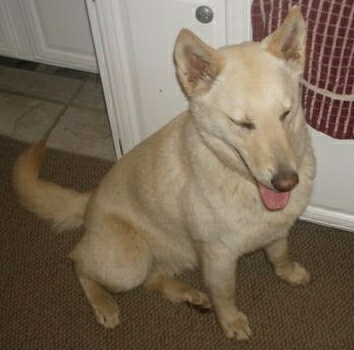
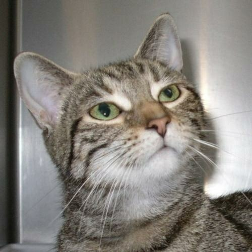
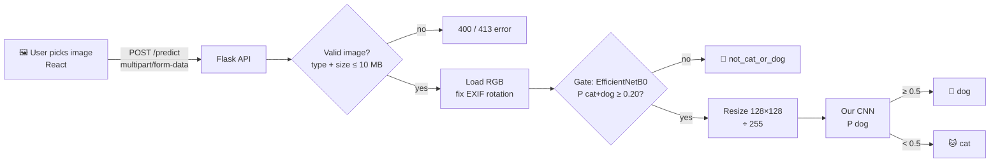
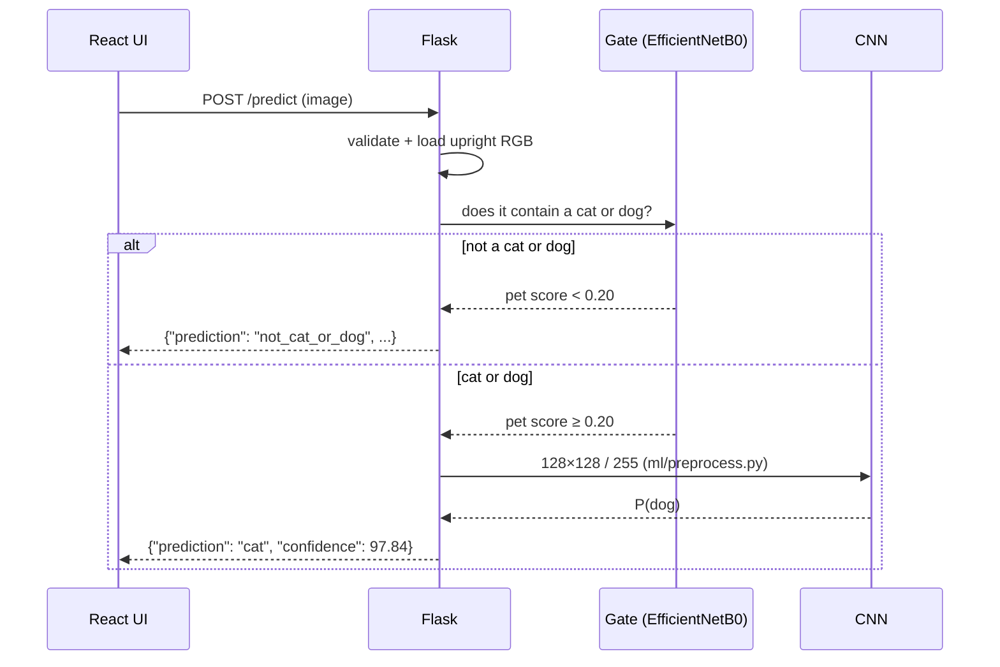
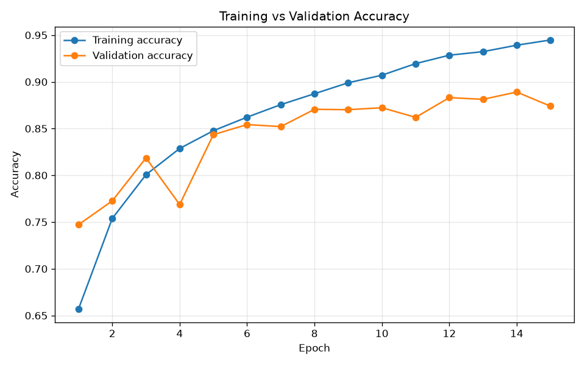
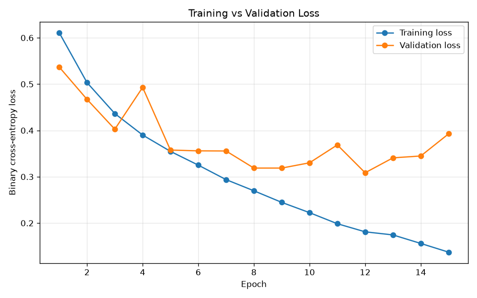
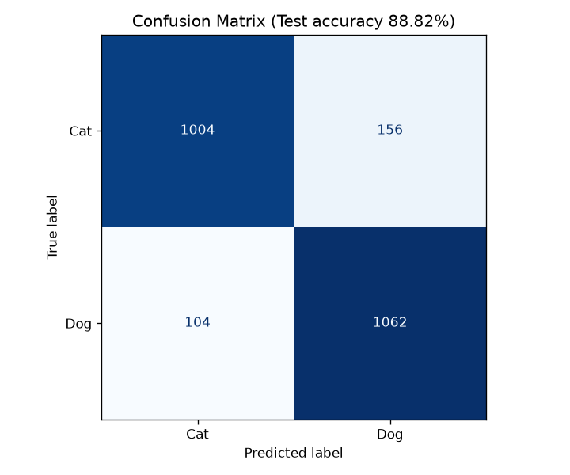
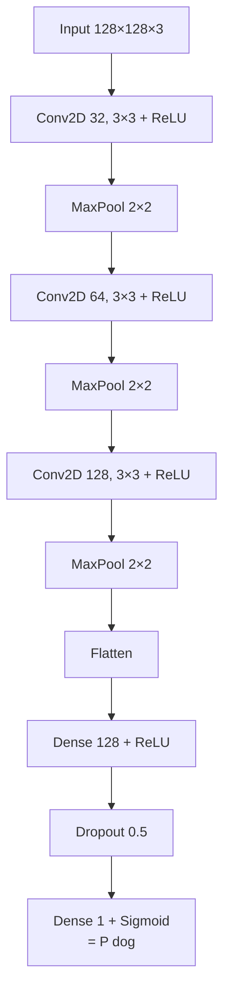

<div align="center">

# 🐱 Cat vs Dog 🐶
### Image classification with a CNN, plus a "gatekeeper" that knows when it's neither


**[Quick start](#-quick-start)** · **[How it works](#-how-it-works)** · **[Results](#-results)** · **[API](#-api-reference)** · **[Architecture](#-cnn-architecture)** · **[FAQ](#-faq)**

</div>

---

A simple Convolutional Neural Network (TensorFlow/Keras) trained on the Microsoft
Cats vs Dogs dataset, served by a Flask API and used from a React (Vite) web page.
Images that contain **neither** a cat nor a dog (people, pigs, cars...) are rejected
by a pretrained EfficientNetB0 "gatekeeper" before the CNN runs.

<table>
<tr>
<td align="center"><br><b>cat</b> ✅</td>
<td align="center"><br><b>dog</b> ✅</td>
<td align="center"><br><b>cat</b> ✅</td>
<td align="center"><br><b>dog</b> ✅</td>
</tr>
</table>

## 🚀 Quick start

> [!NOTE]
> TensorFlow does not support Python 3.14 yet, so a **Python 3.12** virtual
> environment is used (created with [uv](https://docs.astral.sh/uv/)).

<details open>
<summary><b>1️⃣ Install</b></summary>

```bash
git clone <this-repo-url> "cat vs dog"
cd "cat vs dog"
uv venv --python 3.12 .venv
uv pip install --python .venv -r ml/requirements.txt -r backend/requirements.txt
source .venv/bin/activate
```
</details>

<details>
<summary><b>2️⃣ Train &amp; evaluate (optional, a trained model is already included)</b></summary>

```bash
cd ml
python train.py        # downloads the dataset automatically the first time (~20 min on CPU)
python evaluate.py     # test accuracy, confusion matrix, classification report
python predict.py sample_images/cat_1.jpg
```
</details>

<details>
<summary><b>3️⃣ Start the backend</b> (new terminal, venv activated)</summary>

```bash
cd backend
python app.py          # http://localhost:5000
```
</details>

<details>
<summary><b>4️⃣ Start the frontend</b> (new terminal)</summary>

```bash
cd frontend
cp .env.example .env   # VITE_API_URL=http://localhost:5000
npm install
npm run dev            # http://localhost:5173
```
</details>

Open **http://localhost:5173**, pick an image and hit predict. 🎉

## 🧠 How it works



<details>
<summary><b>Step-by-step request lifecycle</b></summary>



1. React sends the selected image to `POST /predict` as `multipart/form-data`.
2. Flask validates the file and loads it upright (EXIF rotation from phone photos is applied) as RGB.
3. **Gate:** EfficientNetB0 checks the image contains a cat or dog; if not, Flask returns `not_cat_or_dog`.
4. **CNN:** the image is resized to 128×128 and divided by 255 (the same `ml/preprocess.py` code used in training). The CNN (loaded once at server start) outputs P(dog): ≥ 0.5 → dog, otherwise cat with confidence 1 − P(dog).
5. Flask returns the JSON and React shows it.
</details>

<details>
<summary><b>🤔 Why a "gate" model?</b></summary>

The CNN has only two outputs, so it must answer cat or dog for *every* image,
even a pig or a person. To handle that, a pretrained EfficientNetB0 (ImageNet,
1000 classes, weights downloaded automatically the first time, ~21 MB) checks
first: it adds up the probability of ImageNet's 118 dog-breed + 5 cat classes.
If that total is below **0.20**, the answer is "not a cat or dog". The cat vs dog
answer itself always comes from our own CNN.
</details>

## 📊 Results

Real numbers from [`ml/results/`](ml/results/):

| Metric | Value |
|---|---|
| Training accuracy (best epoch 12) | 92.85% |
| Validation accuracy (best epoch 12) | 88.31% |
| Training loss | 0.1811 |
| Validation loss | 0.3086 |
| **Test accuracy (2,326 unseen images)** | **88.82%** |
| Gate: genuine cat/dog test images accepted | 97.64% |

<details>
<summary><b>📈 Training curves</b></summary>

| Accuracy | Loss |
|---|---|
|  |  |
</details>

<details>
<summary><b>🧮 Confusion matrix &amp; classification report</b></summary>



|  | predicted cat | predicted dog |
|---|---|---|
| **actual cat** | 1004 | 156 |
| **actual dog** | 104 | 1062 |

| Class | Precision | Recall | F1 | Support |
|---|---|---|---|---|
| cat | 0.9061 | 0.8655 | 0.8854 | 1160 |
| dog | 0.8719 | 0.9108 | 0.8909 | 1166 |
| **macro avg** | 0.8890 | 0.8882 | 0.8882 | 2326 |
</details>

## 🔌 API reference

<details>
<summary><code>GET /health</code></summary>

```json
{ "status": "ok" }
```
</details>

<details>
<summary><code>POST /predict</code>: classify an image</summary>

Send the file in the `image` field (JPG, PNG, BMP, GIF or WEBP, max 10 MB):

```bash
curl -F "image=@ml/sample_images/dog_1.jpg" http://localhost:5000/predict
```

| Case | Status | Body |
|---|---|---|
| Cat / dog | 200 | `{"prediction": "cat", "confidence": 97.84}` |
| Neither | 200 | `{"prediction": "not_cat_or_dog", "confidence": 91.2, "detected": "..."}` |
| No / invalid file | 400 | `{"error": "..."}` |
| Too large | 413 | `{"error": "Image is too large. Maximum size is 10 MB."}` |
| Model failure | 500 | `{"error": "Prediction failed: ..."}` |
</details>

## 🏗️ CNN architecture



<details>
<summary><b>Training configuration</b></summary>

| Setting | Value |
|---|---|
| Loss | Binary cross-entropy |
| Optimizer | Adam (lr 0.001) |
| Batch size | 32 |
| Epochs | Up to 15 |
| Callbacks | EarlyStopping (patience 3, restores best weights), ModelCheckpoint |
| Augmentation | Random horizontal flips |
| Split | 80 / 10 / 10 (train / val / test) |
</details>

## 📁 Project structure

<details>
<summary>Show tree</summary>

```text
cat vs dog/
├── ml/
│   ├── preprocess.py        # shared preprocessing (used by training AND backend)
│   ├── data.py              # automatic dataset download (TFDS) + 80/10/10 split
│   ├── train.py             # builds + trains the CNN, saves model and graphs
│   ├── gate.py              # pretrained EfficientNetB0 "is it a cat or dog at all?" check
│   ├── evaluate.py          # test accuracy, confusion matrix, classification report
│   ├── predict.py           # python predict.py image.jpg
│   ├── requirements.txt
│   ├── models/cat_dog_model.keras
│   ├── results/
│   └── sample_images/       # a few test images for demos
├── backend/
│   ├── app.py               # Flask API: GET /health, POST /predict
│   └── requirements.txt
├── frontend/
│   ├── package.json, vite.config.js, index.html, .env.example
│   └── src/ (main.jsx, App.jsx, App.css)
├── .gitignore
└── README.md
```
</details>

## ❓ FAQ

<details>
<summary>TensorFlow prints oneDNN / CUDA warnings on startup. Is something broken?</summary>

No. Those lines are harmless; the model simply runs on CPU.
</details>

<details>
<summary>Where does the frontend get the API address?</summary>

From `frontend/.env` (`VITE_API_URL=http://localhost:5000`). Copy `frontend/.env.example` to create it. `.env` files are git-ignored.
</details>

<details>
<summary>Do I need to download the dataset manually?</summary>

No. `ml/data.py` downloads it through TensorFlow Datasets the first time you train. It is git-ignored.
</details>
